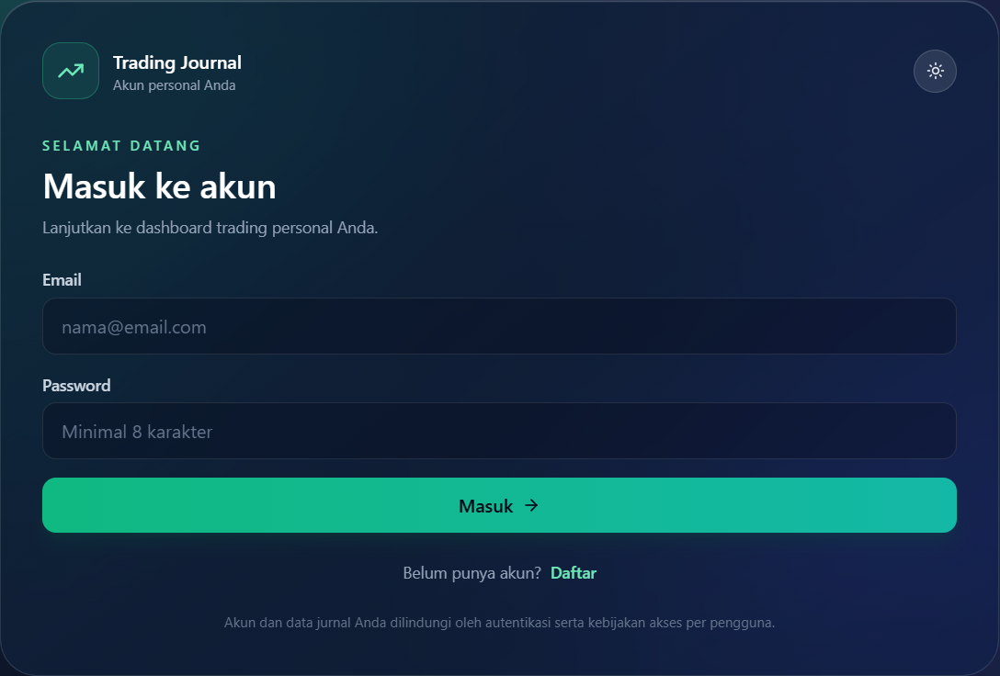
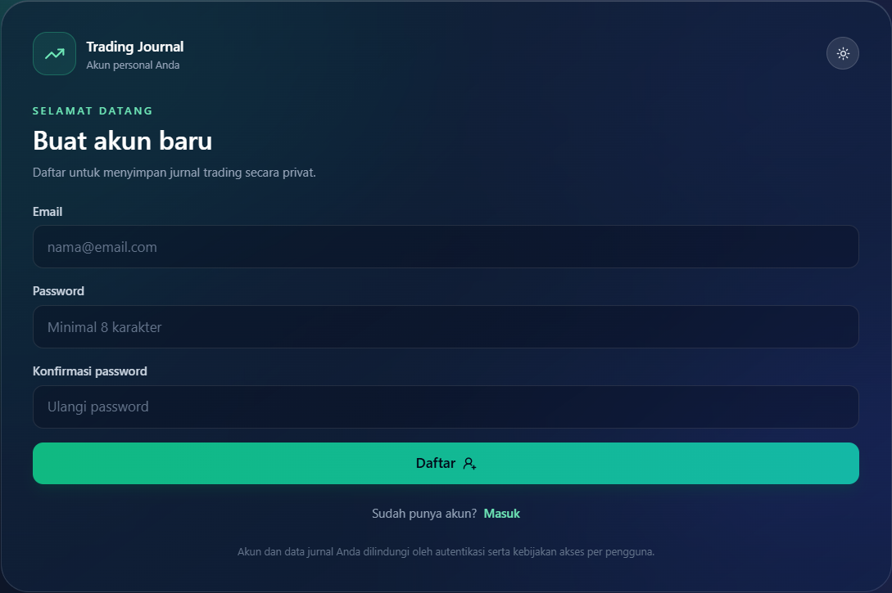
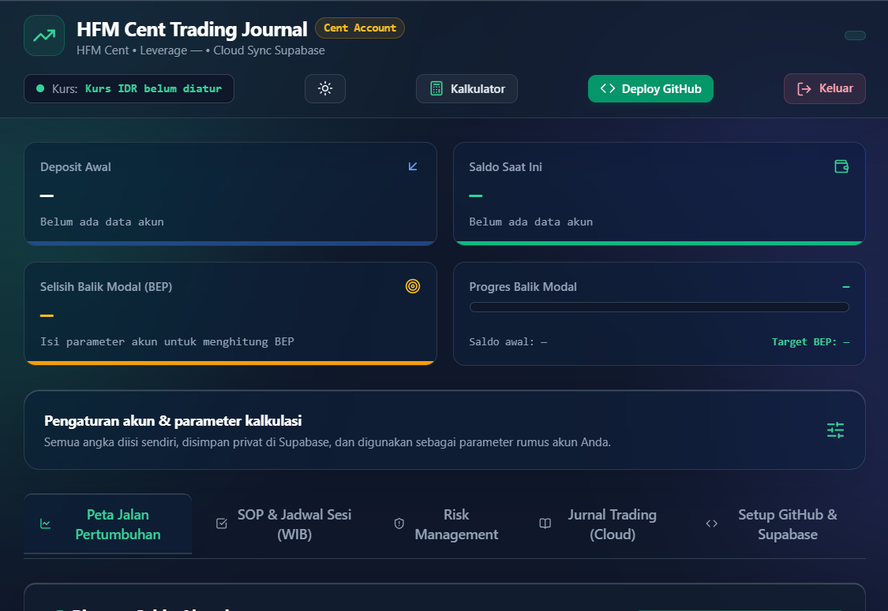
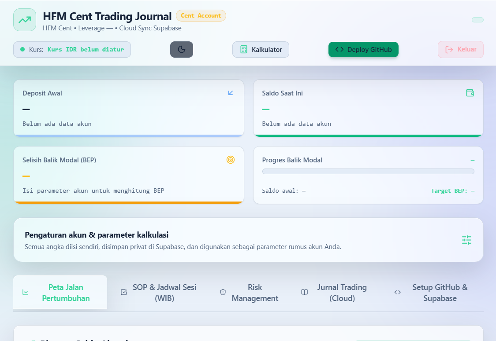

# HFM Cent Account Trading Journal & Risk Planner

Aplikasi web statis berbahasa Indonesia untuk mencatat dan meninjau aktivitas akun trading HFM Cent. Setiap pengguna masuk dengan akun email sendiri; jurnal, saldo, parameter rumus, rencana pertumbuhan, dan arus kas disimpan terpisah berdasarkan identitas Supabase Auth.

## Tampilan

Tangkapan layar berikut adalah pratinjau tampilan. Saldo dan parameter akun tidak diisi otomatis; pengguna mengisinya setelah login.

### Login

### Register

### Dashboard

### Light mode

## Fitur

- **Login dan register email/password** melalui Supabase Auth, termasuk sesi yang bertahan setelah browser ditutup.
- **Jurnal, pengaturan akun, dan arus kas per pengguna:** operasi database memakai `user_id`, dilindungi kebijakan Row Level Security (RLS).
- **Tema dark/light:** pilihan disimpan di browser dan metadata akun, sehingga tetap mengikuti pengguna setelah login.
- **Dashboard aktual:** saldo, BEP, win rate, rugi/profit harian, dan grafik dihitung dari pengaturan akun, deposit/penarikan, serta jurnal yang tersimpan di Supabase.
- **Proyeksi 12 bulan yang dapat diatur:** durasi tiap fase, target harian, hari trading, dan rentang lot diisi pengguna; saldo akhir dihitung berurutan dengan rumus target harian × hari kerja × durasi.
- **SOP dan jadwal sesi:** referensi sesi trading dalam WIB serta checklist persiapan dan eksekusi.
- **Manajemen risiko:** risiko USC dan persentase saldo, ukuran lot sesuai batas risiko, estimasi margin dan kapasitas sebelum stop-out mengikuti parameter akun.
- **Jurnal trading:** catat tanggal, pair, arah/order, lot, harga entry, SL/TP dan hasil pips/USC aktual, status, serta evaluasi.
- **Deposit dan penarikan:** dicatat terpisah dari PnL trading agar perhitungan saldo dan titik BEP dapat ditelusuri.
- **Penyimpanan lokal akun:** jurnal yang belum berhasil tersinkron disimpan di browser dan dapat disinkronkan ulang setelah koneksi pulih.
- **Ekspor dan kalkulator:** ekspor jurnal ke CSV, konversi USC ke IDR dari kurs USD/IDR yang Anda isi, serta simulasi risiko/margin.
- **Tampilan liquid-glass responsif dengan transisi halus:** gaya visual custom berada di `styles.css`; animasi menghormati pengaturan reduced motion pada perangkat.

## Menjalankan aplikasi

Aplikasi ini statis: tidak ada proses build atau instalasi package. Browser memerlukan koneksi internet untuk memuat Supabase JS, Tailwind, Lucide, dan Chart.js dari CDN.

1. Konfigurasikan Supabase seperti langkah di bawah.
2. Host file `index.html`, `styles.css`, dan `supabase-migration.sql` sebagai situs statis.
3. Untuk GitHub Pages, buka **Settings → Pages**, pilih branch `main` dan folder root.

## Konfigurasi Supabase dan login

Project URL dan publishable key project sudah dikonfigurasi di source aplikasi, bukan dimasukkan pengguna melalui formulir di web. Publishable key dapat terlihat di browser; perlindungan data dilakukan dengan Supabase Auth dan RLS.

1. URL project dan publishable key sudah diisi di awal JavaScript pada `index.html`.
2. Buka **Authentication → Providers → Email** dan aktifkan provider Email. Atur **Authentication → URL Configuration** dengan URL situs Anda sebagai Site URL dan Redirect URL.
3. Buka aplikasi dan daftar menggunakan email yang akan memiliki data jurnal lama. Jika verifikasi email aktif, konfirmasi email sebelum masuk.
4. Backup database, lalu buka `supabase-migration.sql`. Ganti `YOUR_REGISTERED_EMAIL` dengan email akun pemilik lama yang sama, kemudian jalankan seluruh query di **Supabase → SQL Editor**.
5. Masuk kembali, isi **Pengaturan akun & parameter kalkulasi**, lalu simpan. Saldo, kurs, spesifikasi lot/pips, aturan risiko, dan seluruh fase proyeksi wajib Anda isi; form tidak memasukkan saldo contoh secara otomatis.
6. Catat deposit/penarikan dan jurnal. Setelah disimpan, seluruh data akun diambil dari Supabase. Pengguna lain dapat mendaftar dengan akun masing-masing.

### Tentang migrasi data lama

Query migrasi menambahkan `user_id`, kolom hasil pips, tabel `trading_account_settings` dan `account_cashflows`, mengubah primary key checklist menjadi gabungan `(user_id, id)`, mengaktifkan RLS, menghapus policy publik lama, lalu membuat policy per pengguna. Baris jurnal lama yang belum memiliki pemilik akan dipindahkan ke **satu email legacy** yang Anda tentukan. Karena tabel lama membagikan semua data dan tidak menyimpan pemilik, query tidak dapat mengetahui pemilik historis per baris. Jika data lama sebenarnya milik beberapa orang, pisahkan/backup dan tentukan pemiliknya terlebih dahulu sebelum menjalankan migrasi.

SQL lengkap yang perlu dijalankan ada di [`supabase-migration.sql`](supabase-migration.sql) dan dapat diunduh melalui tab **Setup GitHub & Supabase** di aplikasi.

## Data dan rumus akun

Tidak ada saldo, kurs, lot, pips, maupun angka proyeksi contoh yang dipakai sebagai data akun otomatis. Setelah login, isi pengaturan akun dan fase rencana pertumbuhan. Nilai tersebut disimpan pada baris Supabase milik pengguna. Hasil USC aktual dan pips trade dicatat dari riwayat broker; aplikasi tidak mengakses harga atau posisi MetaTrader.

- Kurs USC/IDR = kurs USD/IDR ÷ 100; nilai rupiah = USC × kurs USC/IDR.
- Saldo berjalan = saldo awal tracking + PnL jurnal + deposit tambahan − penarikan.
- Target BEP = total deposit awal + deposit tambahan; gap = nilai maksimum antara nol dan target BEP − saldo berjalan.
- Progress BEP = minimum 100% dan saldo berjalan ÷ target BEP × 100%; estimasi hari = pembulatan ke atas gap ÷ target profit harian fase pertama.
- Risiko USC = SL pips × lot × nilai USC per pip per lot. Pengaturan batas risiko dibatasi maksimal 3% saldo.
- Margin USC = lot × unit Cent per lot × harga aset ÷ leverage. Kapasitas pips teoritis sebelum stop-out = (saldo berjalan − level stop-out × margin) ÷ (lot × nilai pip per lot).
- Proyeksi tiap fase = target profit harian × hari trading per bulan × durasi fase; saldo fase berikutnya memakai saldo akhir fase sebelumnya. Total durasi rencana harus 12 bulan.
- Batas jurnal harian maksimal dua trade; rugi harian, drawdown mingguan, SL/TP, rasio risk:reward, dan pemicu BE+ dibandingkan dengan parameter yang Anda simpan.

Parameter nilai pip, kurs, leverage, unit per lot, dan harga aset adalah input pengguna yang perlu dicocokkan dengan spesifikasi instrumen/broker. Semua proyeksi bersifat simulasi, bukan prediksi atau jaminan hasil.

## Tema

Dark mode aktif secara default. Tombol tema di layar login atau dashboard mengubah ke light mode dan sebaliknya. Preferensi disimpan lokal dan disinkronkan ke metadata akun Supabase, sehingga tetap sama setelah browser ditutup atau pengguna login lagi. Metadata tema tidak menyimpan data jurnal.

## Keamanan

- RLS membatasi baca/tambah/ubah/hapus jurnal, checklist, pengaturan akun, dan arus kas ke `auth.uid() = user_id`.
- Policy lama `Public Access ...` dihapus oleh migrasi; jangan menambahkan kembali policy dengan `using (true)` atau `with check (true)`.
- Konfigurasi frontend menggunakan publishable key yang memang tersedia di browser. Lindungi data dengan RLS dan jangan pernah memakai atau commit `service_role` key.
- Data legacy lama ditetapkan ke satu akun yang dipilih saat migrasi; backup database sebelum menjalankan SQL.

## Catatan aplikasi

- Aplikasi ini alat pencatatan dan referensi, **bukan** platform broker: tidak mengambil harga live, mengirim order, atau terhubung ke MetaTrader.
- Peringatan trade/rugi/drawdown merupakan panduan dari jurnal trade tertutup, bukan pemblokiran transaksi atau pengelolaan posisi aktif. Aplikasi tidak dapat mengurangi lot atau menggeser stop loss di broker.
- Grafik saldo aktual memakai jurnal dan arus kas Supabase. Proyeksi memakai target yang Anda isi, bukan data trading live.
- Kurs konversi dimasukkan pengguna dan bukan kurs live.
- Informasi strategi, risiko, dan proyeksi bukan nasihat keuangan maupun jaminan hasil.
